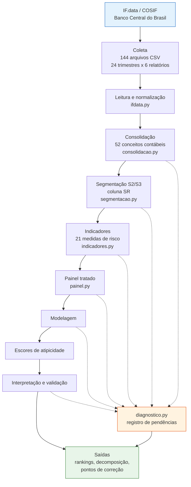
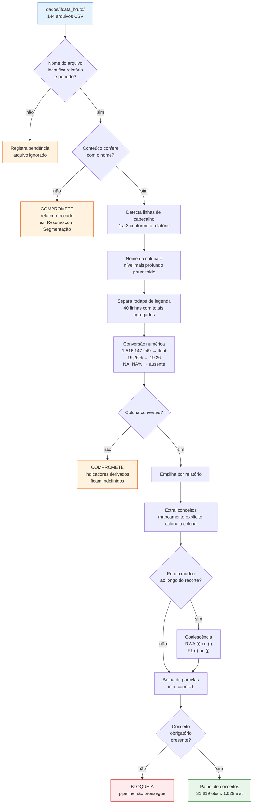
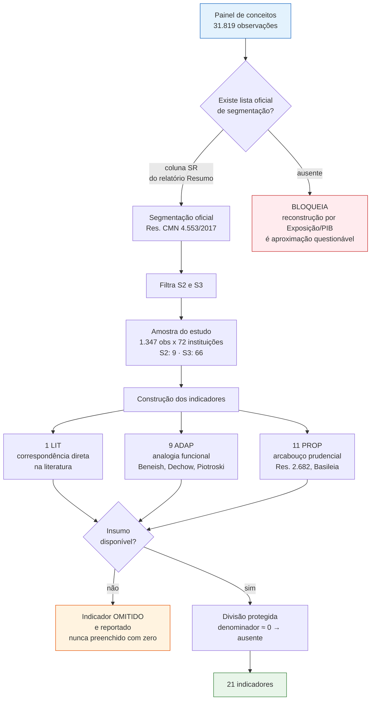
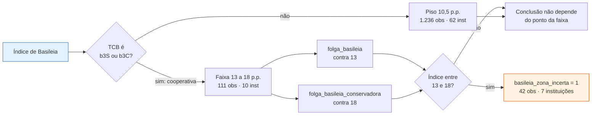
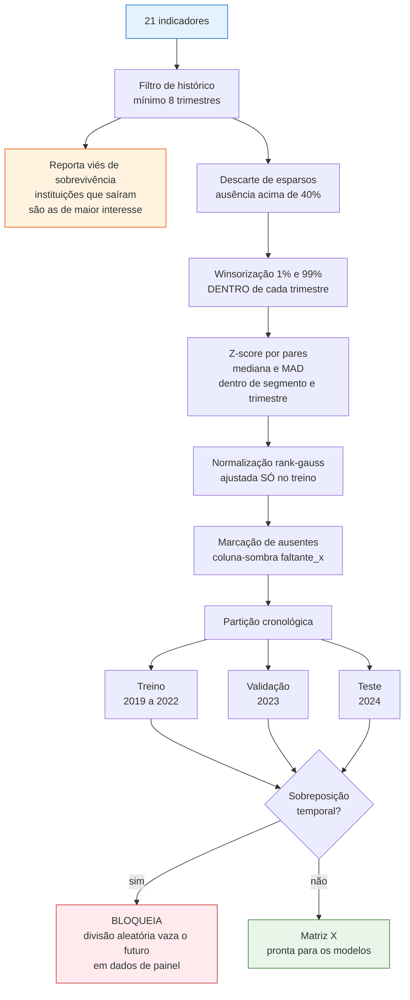
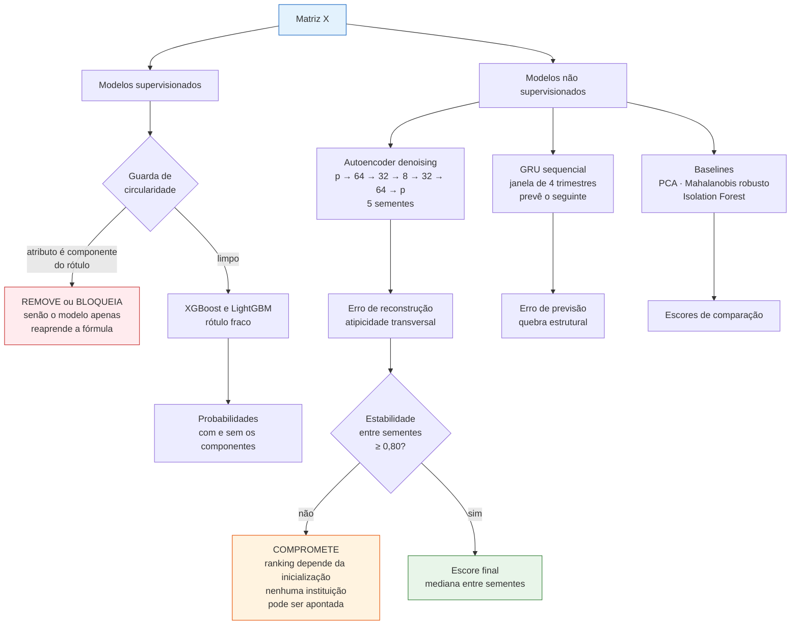
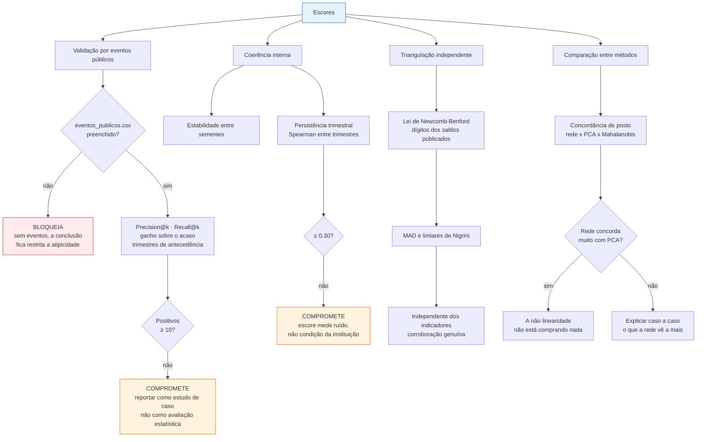
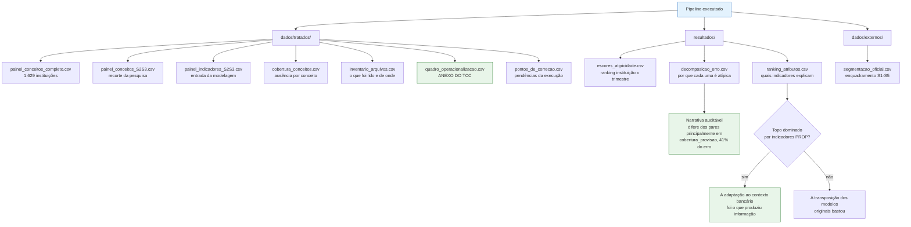
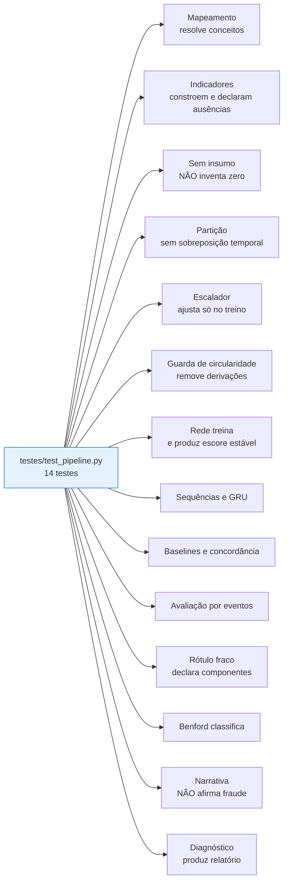

# Fluxograma das operações

Diagramas do pipeline completo: da entrada dos dados às saídas, com as
verificações em cada etapa e o que cada uma bloqueia.

> **Como visualizar.** O VS Code renderiza Mermaid no preview de Markdown
> (`Ctrl+Shift+V`). Para exportar como imagem e inserir no TCC, use a extensão
> *Markdown Preview Mermaid Support* (botão de exportar no diagrama) ou copie o
> bloco em <https://mermaid.live> e baixe em PNG ou SVG.

---

## 1. Visão geral

A linha pontilhada é o registro de pendências: **toda etapa pode reportar uma
limitação**, e o relatório final consolida todas. Ausência nunca vira zero
silencioso.

---

## 2. Entrada e tratamento dos dados

---

## 3. Segmentação e construção dos indicadores

**Piso de Basileia**, aplicado dentro de `folga_basileia`:

---

## 4. Tratamento do painel e partição

**Por que cada decisão:** winsorizar por trimestre preserva a comparação
transversal, já que as contas mudam de escala ao longo do período; o z-score
por pares faz a pergunta ser *"destoa dos pares agora?"* em vez de *"destoa da
população inteira?"*; ajustar a normalização só no treino evita que o modelo
veja a distribuição do futuro; e marcar ausentes impede que a média imputada
faça a ausência parecer normalidade.

---

## 5. Modelagem

---

## 6. Avaliação e verificações

Tanto `E3` quanto `E4` são resultados publicáveis. O que não é aceitável é
**não fazer a comparação**.

---

## 7. Saídas

O teste em `F` é o achado metodológico mais forte que o desenho pode entregar:
responde se os indicadores prudenciais propostos carregam informação que a
simples transposição de modelos de empresa não financeira não carregaria.

---

## 8. Testes automatizados

Os testes `D` e `N` merecem destaque: o primeiro garante que indicador sem
insumo é omitido e reportado, nunca preenchido com zero; o segundo garante que
o texto gerado fala em *atipicidade* e nunca em *fraude*. São verificações de
integridade metodológica, não apenas de funcionamento.

Ferramentas auxiliares, fora da suíte:

| Script | Função |
|---|---|
| `testes/diagnostico_rede.py` | Acesso ao IF.data: DNS, TCP, TLS, HTTP |
| `testes/validar_extracao_manual.py` | Cobertura, duplicidade, formato, colunas |
| `testes/organizar_downloads.py` | Renomeia downloads pela ordem cronológica |
| `processar_base.py` | Executa o tratamento completo |

---

## 9. Legenda das severidades

| Marca | Significado |
|---|---|
| **BLOQUEIA** | Os escores não devem ser reportados no TCC enquanto não resolvido |
| **COMPROMETE** | Pode ser reportado, com ressalva explícita no texto |
| **OBSERVAÇÃO** | Transparência; não invalida nada |

Ausência de pendências não equivale a validação metodológica — significa apenas
que nenhuma verificação automatizada falhou.
